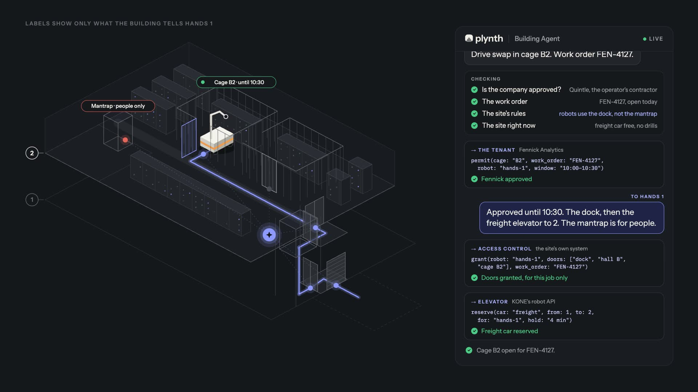

<picture>
  <source media="(prefers-color-scheme: dark)" srcset="assets/plynth-lockup-paper.svg">
  
</picture>

### The physical AI layer for buildings.

Agentic middleware to onboard any robot into buildings, on the owner's rules.

Robots that work in the lab stall in real buildings: elevators, badge doors and security were built for people, so today a person walks each robot through. Plynth is the building's side of deployment.

- **One API for every fleet.** Signed HTTPS, an OpenAPI 3.1 spec and an event stream. A fleet integrates once.
- **Adapters to the building's systems.** Elevator makers' robot APIs (KONE today), badge systems (through Seam) and the fire alarm.
- **Go-lives as code.** A sandbox, a conformance suite, witnessed tests and the owner's sign-off.
- **A trace of every trip.** Each rule that decided and each call to a building system, exported for auditors.
- **The building's agent.** It hears each request; the owner's rules decide, and life safety always wins.

The film is at [plynth.build](https://www.plynth.build). Simulated devices.

**October 2026:** running end to end on simulated devices and in the makers' sandboxes: elevator rides through KONE's robot API, badge doors through Seam's sandbox, 345 automated tests. Python and SQLite on site, React and three.js for the owner's app, Claude for the building's agent. Starting in AI data centers.

The code is private. For access, write to [studio@plynth.build](mailto:studio@plynth.build).
